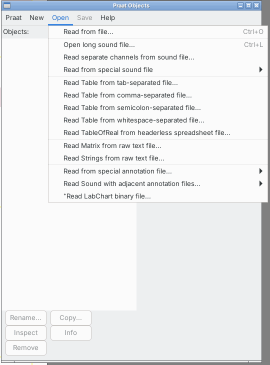
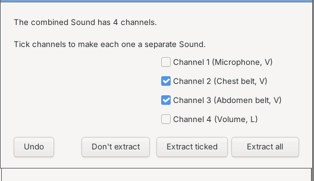
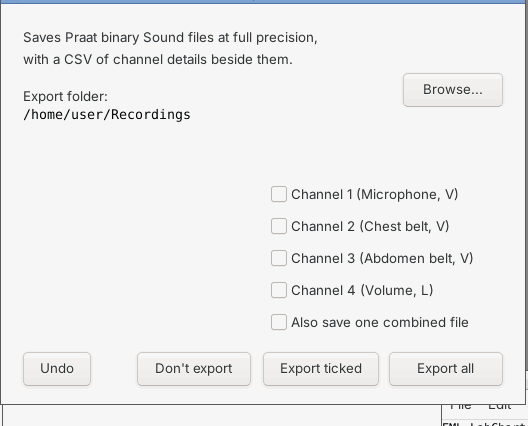
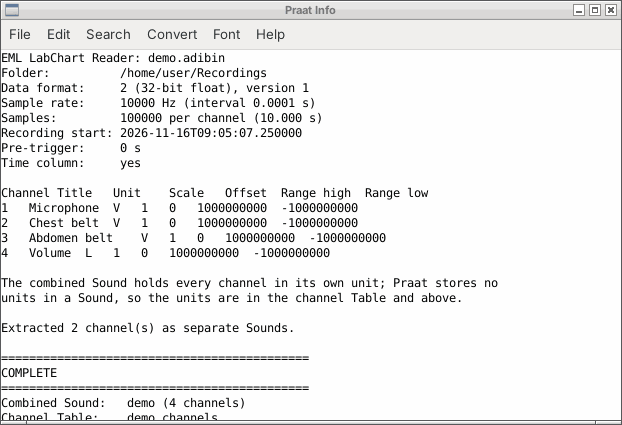
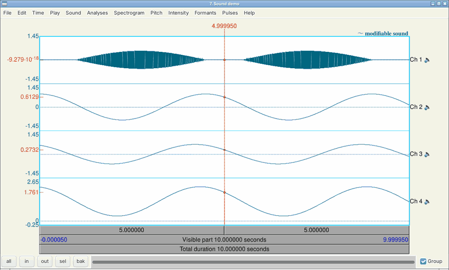

# EML LabChart Reader for Praat

EML LabChart Reader is a Praat plugin that opens LabChart "ADInstruments binary" exports (`.adibin` files) at full resolution. It reads the file in memory, with no intermediate file. Every channel keeps its recorded units, and the channel names, units, sample rate and recording start time come from the file itself.

This plugin is in beta. Versions stay below 1.0.0 until the first public release.

## What you get

When you open a file, the plugin leaves these objects in the Objects window, selected:

- **A combined Sound** named after the file. It has one channel per LabChart channel, in file order, on the file's own time axis. The first sample sits at the file's first time value.
- **A channel Table** named `<file>_channels`. It has one row per channel: number, title, unit, scale, offset, range high, range low, sample rate, recording start, pre-trigger time, data format and sample count.

A Praat Sound has no place for channel names or units, so the Table is where they live. The Info window shows the same details.

Two dialogs follow. In both, the default button changes nothing.

1. **Extract channels.** Tick channels and click **Extract ticked**, or click **Extract all**. Each extracted channel becomes its own Sound, named `<title>_<unit>`, for example `EGG_mV`.
2. **Export channels.** Choose a folder (the `.adibin` file's folder by default; an empty folder field also means that folder), tick channels and click **Export ticked**, or click **Export all**. Each exported channel is saved as a Praat binary Sound file, `<file>_<title>_<unit>.Sound`, at full precision. Tick **Also save one combined file** to save the exported channels together as `<file>_combined.Sound`. Every export also writes `<file>_channels.csv`, with one row per exported channel and the file's header details. Empty values are blank cells. The plugin never overwrites an exported file: it adds `_1`, `_2` and so on to the name instead.

The plugin remembers your ticks, by channel title, and your combined-file choice for the next run.

## Install

You can install the plugin either way.

### Option A: install by hand

1. On the [latest release](https://github.com/embodied-music-lab/EMLLabChartReader/releases/latest) page, download **Source code (zip)** and unzip it.
2. Copy the folder `plugin_EMLLabChartReader` from inside it into your Praat preferences folder, so that it sits directly inside that folder:

   | System | Praat 7 | Praat 6 |
   |---|---|---|
   | macOS | `~/Library/Application Support/Praat/` | `~/Library/Preferences/Praat Prefs/` |
   | Windows | `C:\Users\<name>\AppData\Roaming\Praat\` | `C:\Users\<name>\Praat\` |
   | Linux | `~/.config/praat/` | `~/.praat-dir/` |

3. Restart Praat.

### Option B: install with the EML Plugin Manager

The EML Plugin Manager installs Praat plugins for you, so you don't need to find Praat's preferences folder. It isn't public yet. This option applies once it is.

1. Download `eml-plugin-manager-install.praat` from the Plugin Manager's repository. In Praat, choose **Praat > Open Praat script...**, open the file, and run it. It installs the Plugin Manager.
2. Restart Praat.
3. On the [latest release](https://github.com/embodied-music-lab/EMLLabChartReader/releases/latest) page, download **Source code (zip)**.
4. In Praat, choose **Praat > EML Plugin Manager: Install plugin from disk...**, select the zip, and follow the dialog. The Plugin Manager finds the `plugin_EMLLabChartReader` folder inside the zip.
5. Restart Praat.

The Plugin Manager needs Praat 6.6.30 or newer. Under Praat 7, choose **Approve for this session** when Praat asks for permission.

If you already have the Plugin Manager, start at step 3.

The plugin needs Praat 6.4.39 or newer. It was tested on Praat 6.6.30 and 7.0.03 on Linux.

## Use

In the Objects window, choose **Open > Read LabChart binary file...** and pick the `.adibin` file.

The plugin reads the file into one multichannel Sound and a channel Table, and then asks whether you want any channels as separate Sounds. The default is to extract none.

Next it asks whether to export. The default is not to export. If you export, the plugin saves each ticked channel as a Praat binary `.Sound` file, with a CSV of channel details beside them. You can also save the ticked channels together as one combined file. The plugin remembers your choices for next time.

The Info window lists the file's header and every channel's title, unit, scale, offset and range.

The combined Sound opens in Praat's Sound editor like any other Sound.

The screenshots show a synthetic four-channel file in Praat 6.6.30 on Linux.

Praat 7 asks your permission before a script writes a file. You see that question when you export, and when the plugin saves changed settings.

## How values are read

- Data formats 1 (64-bit float), 2 (32-bit float) and 3 (16-bit integer) are read, with or without a time column.
- A real value is (stored value + offset) × scale. When a channel's scale isn't 1 or its offset isn't 0, the plugin applies that rule and says so in the Info window. This rule follows the file format's description; it hasn't yet been checked against a LabChart file whose scale isn't 1 or whose offset isn't 0.
- Infinite and not-a-number samples are kept as undefined, and the Info window gives the count per channel.
- The time column is checked against the time axis and then dropped. If they differ by more than half a sample, the Info window says so.
- In 16-bit integer files, a time column is stored like the data and can't hold real times, so it is dropped without the check and the first sample sits at 0 s.
- The pre-trigger time is reported in the Table and the CSV. It doesn't move the time axis.
- The file must start with `CFWB` and be at least as long as its header says. Otherwise the plugin stops with a message.

## Tests

`tests/make_fixtures.py` writes small synthetic `.adibin` files with known values into `tests/fixtures/`, and the values each one should decode to into `tests/expected.json`. The test runner calls it first, so you don't need to run it yourself.

- `PRAAT=/path/to/praat bash tests/run_tests.sh` decodes every fixture with the plugin's reader in batch Praat and checks every value, the time axis and the refusals.
- `PRAAT=/path/to/praat bash build.sh check` builds the plugin and confirms that Praat runs its setup without error.
- `PRAAT=/path/to/praat bash tests/verify_install.sh` installs the built zip into a scratch home and confirms the menu entry appears (Linux, needs Xvfb, xdotool, ImageMagick and tesseract).

## Build

`bash build.sh` copies `plugin_EMLLabChartReader/` into `dist/`, sets file modes and writes `dist/plugin_EMLLabChartReader.zip`. The plugin name is declared once, at the top of `build.sh`. The version is declared once, in `plugin_EMLLabChartReader/VERSION`, which the EML Plugin Manager also reads. The build stops if a script header gives a different version.

## License and attribution

GPL-3.0-or-later. See `LICENSE`.

Built with EML PraatGen by Ian Howell, Embodied Music Lab (www.embodiedmusiclab.com, https://github.com/embodied-music-lab/PraatGen), with code generation by Claude (Anthropic).
